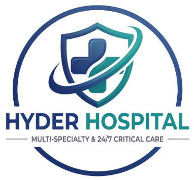

# Hyder Hospital - Multi-Specialty & 24/7 Critical Care (Nandyal)

A modern, clinical-grade web application for **Hyder Hospital**, a premier multi-specialty tertiary healthcare center in Nandyal, Andhra Pradesh.



## Overview & Highlights

- **Cinematic Video Hero Section**: High-contrast, responsive video background with luxury dark navy glassmorphic overlays.
- **Hyder Hospital AI Voice Assistant**: Interactive conversational mock assistant with real-time animated waveform visualizer, quick voice prompts, and direct consultation booking.
- **Specialty Care Explorer**: Interactive filtering for Mother & Child Health (OBGYN), 24/7 ICU/NICU/PICU, General Medicine, Orthopaedics & Trauma, Eye Care, and Dental Surgery.
- **Doctor Roster & OPD Scheduling**: Real-time doctor consultation booking with interactive token generation.
- **Digital OPD Token Slip**: Instant printable and downloadable PDF appointment token slips with token IDs (`#OPD-XX`) and WhatsApp integration.
- **24/7 Emergency SOS**: Instant 1-click hospital ER dialer (`08514-220022`), Govt 108 Ambulance integration, and emergency triage protocols.
- **Live Hospital Vitals Tracker**: Dynamic vacancy tracker for Adult ICU and NICU beds with live timestamp refreshes.
- **NABH Accredited Infrastructure**: Barrier-free campus with wheelchair ramps, 24/7 pharmacy, diagnostic labs, and digital C-Arm operation theaters.

## Technologies Used

- **HTML5 & Semantic Markup**
- **Vanilla CSS & Tailwind CSS**
- **JavaScript (ES6+)**
- **Material Symbols & Google Fonts (Plus Jakarta Sans & Inter)**
- **Video & High-Resolution Brand Identity Assets**

## Getting Started

To run locally:
```bash
# Clone the repository
git clone https://github.com/shaikmuskan27/Hyder-Hospital-.git

# Navigate into the folder
cd Hyder-Hospital-

# Start a local static server
python -m http.server 8080
```
Open `http://localhost:8080` in your web browser.

---
© 2026 Hyder Hospital, Nandyala. All clinical rights reserved.
